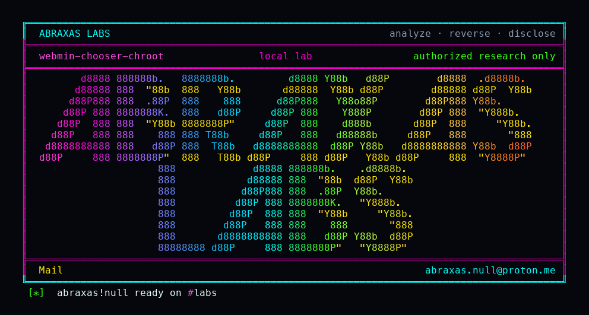

<p align="center">
  
</p>

# webmin-chooser-chroot

A signed-in Webmin user who is only supposed to pick files inside one folder can still see names of files outside it. They open the file picker, pass a `chroot` path that starts with their folder then walks up, and the listing leaves the jail. Names, sizes, and dates only. Not file contents. This only bites when that picker root is not the whole disk.

**Class:** Path listing
**Reach:** Remote (signed-in user whose chooser root is not `/`)

**Webmin** `2.670` (`3a2b2b86`) - Webmin

I logged in as a user whose chooser root was `/lab/jail`. `file=../` stayed in the jail. `chroot=/lab/jail/../` listed a filename I had planted one directory up. The File Manager search path on this tag already stays inside `allowed_paths`. This is the other window.

| | |
|---|---|
| ID | no CVE yet |
| Class | **Path listing** (`chooser.cgi` `chroot` prefix plus `..`) |
| Reach | **Remote** (signed-in user whose global chooser `root` is not `/`) |
| CWE | [CWE-22](https://cwe.mitre.org/data/definitions/22.html) |
| CVSS | **Medium: 5.3** `CVSS:3.1/AV:N/AC:L/PR:L/UI:N/S:U/C:L/I:N/A:N` |
| Product | [Webmin](https://github.com/webmin/webmin) |
| Affected | **2.670** (`3a2b2b8671c0669c129f5275b3dd1853106ae02b`) |
| Auth | session cookie; chooser `root` set to a directory other than `/` |
| License | [GNU Affero GPL v3.0](LICENSE) |
| Lab | loopback 127.0.0.1:18510. Compose `webminh21`. |

## What an attacker can do

Needs a Webmin login whose file-chooser `root` is a real jail (home, or an explicit directory). Default `root=/` already lists the disk and is not this bug. `chooser.cgi` is not under a module, so module ACL is not the gate. `fileunix` still defaults to `root`, so the listing often runs as root even for a limited Webmin user.

| Privilege | Method / sink | Recon / integrity / availability | Lab-proven or inferred |
|---|---|---|---|
| List the jail only | `GET /chooser.cgi?frame=1&type=0` | Recon of names inside `root` | Lab-proven. `allowed.txt` present, witness absent |
| Walk with `file=../` | `chooser.cgi:84` rejects `..` in `file` | n/a (negative) | Lab-proven. stayed in jail |
| List outside the jail | `GET /chooser.cgi?frame=1&type=0&chroot=/lab/jail/../` | Recon: names, sizes, mtimes outside `root` | Lab-proven. witness filename listed |
| List other homes / root-only dirs | same sink, `fileunix=root` | Recon of names the Unix user can `stat` | Inferred. lab listed `/lab`, not `/root` |
| Read file bodies | chooser columns | n/a | Closed. names, sizes, mtimes only |

**Stays closed on this leftover**

| Axis | Method / sink | Why it is closed |
|---|---|---|
| Recon | `file=../` | `chooser.cgi:84` |
| Recon | File Manager search / listing | `filemin/search.cgi` filters to `allowed_paths` on this tag |
| Recon | `help.cgi` `..` | miniserv simplifies `PATH_INFO` before `read_help_file` |
| Recon | Default `root=/` | already lists everything; not this bug |
| Integrity | File write, extract, shell | not this CGI |
| Recon | Unauthenticated chooser | needs a session |

The picker is the "..." button from `file_chooser_button`. In ordinary words: the popup that is supposed to stay in one folder still has a second path argument, and that one is not canonicalized.

## How I found it

[`chooser.cgi:62-64`](https://github.com/webmin/webmin/blob/3a2b2b8671c0669c129f5275b3dd1853106ae02b/chooser.cgi#L62-L64) treats `chroot` as inside the jail when it is a **string prefix** of `root`, then sets `$rootdir` undef. `allowed_dir` treats undef as empty and returns 1. `..` is rejected only in `file`. `opendir` uses `$in{'chroot'}.$dir` as-is.

Wrong turns: treating the 2.670 File Manager listing fix as this CGI; stopping after `file=../` came back clean; calling default `root=/` a finding.

## Lab

```bash
python3 webmin-chooser-chroot-Abraxas-Labs.py
```

or:

```bash
cd lab
./run.sh
```

Clones [webmin/webmin](https://github.com/webmin/webmin) tag `2.670` (`3a2b2b8671c0669c129f5275b3dd1853106ae02b`) into `lab/src` and reuses `webmin-lab:2.670` when present. Loopback only.

```text
SUCCESS WEBMIN-H21-CHOOSER how=live chroot-prefix-escape=yes file-dotdot-rejected=yes WEBMIN-H21-CHOOSER
```

## The fix

Canonicalize `chroot` (`resolve_links` or equivalent). Reject `..` in `chroot` the same way `file` already does. Do not clear `$rootdir` on a string prefix. Keep the jail so `allowed_dir` still runs `is_under_directory` on the real path.

## References

- [github.com/webmin/webmin](https://github.com/webmin/webmin) `3a2b2b8671c0669c129f5275b3dd1853106ae02b`
- [`chooser.cgi`](https://github.com/webmin/webmin/blob/3a2b2b8671c0669c129f5275b3dd1853106ae02b/chooser.cgi)
- [`file_chooser_button`](https://github.com/webmin/webmin/blob/3a2b2b8671c0669c129f5275b3dd1853106ae02b/web-lib-funcs.pl#L2836)
- [CWE-22](https://cwe.mitre.org/data/definitions/22.html)
- [webmin.com/security](https://webmin.com/security/)

## License

GNU Affero GPL v3.0. See [LICENSE](LICENSE). Loopback lab only. No warranty.

Abraxas Labs
abraxas.null@proton.me
